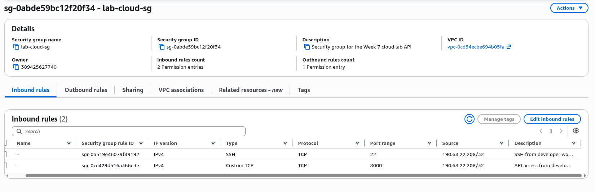

# AWS EC2 Setup and Security Groups

This document describes how to create a free-tier EC2 instance on AWS Educate,
how to configure the Security Group with strict inbound rules, and how to
connect securely over SSH. It also explains what **not** to do and why.

## 1. Concepts You Must Understand Before Creating Anything

### VPC, Subnet, Internet Gateway

- **VPC (Virtual Private Cloud):** an isolated virtual network dedicated to your
  AWS account. It has its own IP range (for example `172.31.0.0/16`).
- **Subnet:** a subdivision of the VPC inside a single Availability Zone. A
  public subnet is one that has a route to an Internet Gateway.
- **Internet Gateway (IGW):** the component that allows resources inside a
  public subnet to reach and be reached from the Internet.
- **Route table:** defines where the traffic of a subnet goes. A public subnet
  has a route `0.0.0.0/0 -> igw-xxxx`.

### Security Groups

A Security Group (SG) is a stateful virtual firewall attached to an instance.
It has two sets of rules:

- **Inbound rules:** traffic entering the instance.
- **Outbound rules:** traffic leaving the instance.

Being stateful means that if an inbound connection is allowed, the response
traffic is automatically allowed even if there is no matching outbound rule.

### The `default` Security Group Trap

Every VPC ships with a Security Group literally named `default`. Its default
rules depend on how the VPC was created, and in older VPCs it often contains:

- Inbound: `All traffic` from `sg-xxxxxxxx` (self-referencing).
- Outbound: `All traffic` to `0.0.0.0/0`.

Some accounts additionally have `SSH (22)` open to `0.0.0.0/0`. **Never use the
`default` Security Group for anything.** Create a dedicated Security Group for
each workload so you know exactly what each rule is for and you can delete it
without side effects.

If you already launched an instance with the `default` SG, remove the instance
from that SG and attach a new one. Do not modify the `default` SG because other
resources in the account may depend on it.

## 2. Creating a Dedicated Security Group

In the AWS Console:

1. Open **EC2 > Security Groups > Create security group**.
2. Name it `lab-cloud-sg` and describe it as
   `Security group for the Week 7 cloud lab API`.
3. Select the VPC where the instance will run.
4. Configure the **Inbound rules** as follows:

   | Type        | Protocol | Port range | Source              | Purpose                                     |
   |-------------|----------|------------|---------------------|---------------------------------------------|
   | SSH         | TCP      | 22         | `<your-ip>/32`      | Administrative access from your machine only|
   | Custom TCP  | TCP      | 8000       | `<your-ip>/32`      | API access for testing from your machine    |

   Replace `<your-ip>` with your current public IP. To find it:

   ```bash
   curl ifconfig.me
   ```

   **Do not add `0.0.0.0/0` for ports 22 or 8000.** Opening SSH to the entire
   Internet exposes the instance to automated brute-force attacks within
   minutes. Opening the API to the entire Internet exposes your data and
   credentials.

5. Configure the **Outbound rules**. The default `All traffic to 0.0.0.0/0` is
   acceptable for this lab because the instance needs to reach MongoDB Atlas,
   the package repositories, and Docker Hub. If you want a stricter setup,
   restrict outbound to:

   | Type        | Protocol | Port range | Destination              |
   |-------------|----------|------------|--------------------------|
   | DNS (UDP)   | UDP      | 53         | `0.0.0.0/0`              |
   | DNS (TCP)   | TCP      | 53         | `0.0.0.0/0`              |
   | HTTPS       | TCP      | 443        | `0.0.0.0/0`              |
   | HTTP        | TCP      | 80         | `0.0.0.0/0`              |

   HTTP and HTTPS are needed for `dnf`, `git`, Docker pulls, and `mongodb+srv`
   connections. DNS is needed for name resolution.

6. Review the rules, then click **Create security group**.

## 3. Launching the Instance

1. Open **EC2 > Instances > Launch instances**.
2. Name the instance `lab-cloud-api`.
3. Choose the **Amazon Linux 2023** AMI (free tier eligible).
4. Choose `t3.micro` (free tier eligible in us-east-2).
5. In **Key pair**, click **Create new key pair**:
   - Name: `lab-cloud-key`
   - Type: **ED25519** (modern, smaller than RSA).
   - Format: `.pem`.
   - Download the file and move it to `~/.ssh/`.
6. In **Network settings**, click **Edit** and:
   - Select the VPC and a public subnet.
   - Enable **Auto-assign public IP**.
   - Select **Select existing security group** and choose `lab-cloud-sg` (not
     `default`).
7. In **Configure storage**, leave the default 8 GiB gp3 volume (free tier
   eligible).
8. Click **Launch instance** and wait until the state is `running`.

## 4. Restricting the Private Key

On your local machine:

```bash
mv ~/Downloads/lab-cloud-key.pem ~/.ssh/lab-cloud-key.pem
chmod 400 ~/.ssh/lab-cloud-key.pem
```

SSH refuses to use a key with permissions more permissive than `0400`. Never
commit the `.pem` file to any repository.

## 5. Connecting over SSH

Retrieve the public IP from the EC2 console and connect:

```bash
ssh -i ~/.ssh/lab-cloud-key.pem ec2-user@<public-ip>
```

On the first connection you will be prompted to accept the host fingerprint.
Type `yes` only after verifying the fingerprint shown in the console (EC2 >
Instance > Actions > Monitor and troubleshoot > Get system log).

Once inside, validate:

```bash
hostname
uname -a
whoami
```

You should see `ec2-user`, an Amazon Linux 2023 kernel, and the internal
hostname of the instance.

## 6. Hardening SSH

Edit the SSH daemon configuration on the instance:

```bash
sudo vi /etc/ssh/sshd_config.d/99-hardening.conf
```

Add:

```
PasswordAuthentication no
PermitRootLogin no
PubkeyAuthentication yes
```

Restart the SSH daemon:

```bash
sudo systemctl restart sshd
```

Keep the current session open until you have confirmed in a second terminal
that SSH still works with the key. Otherwise you may lock yourself out.

## 7. What Not to Do

- **Do not** use `0.0.0.0/0` as the source for SSH, the API port, or any
  administrative port.
- **Do not** use the `default` Security Group.
- **Do not** enable password authentication over SSH.
- **Do not** store the `.pem` file in the repository, in cloud storage, or in
  chat applications.
- **Do not** expose the MongoDB port (`27017`) to the Internet. When using
  MongoDB Atlas, the connection goes outbound from the instance to Atlas; there
  is no need for an inbound rule.
- **Do not** attach an Elastic IP unless strictly necessary; unattached
  Elastic IPs incur charges.
- **Do not** leave the instance running when you are not using it. Stop it from
  the console. Terminate it at the end of the lab.

## 8. Verifying the Rules from the Outside

From a machine **different** from your usual one (for example, a mobile hotspot
or a friend's network), try to connect:

```bash
nc -vz <public-ip> 22
nc -vz <public-ip> 8000
```

Both commands should time out. This confirms that the rules are restricted to
your specific IP and not to the whole Internet.

## 9. Screenshots to Capture for the Report

Store them under `docs/screenshots/` with descriptive names:

- `aws-account-profile.png` - AWS Educate profile page.
- `aws-sg-inbound.png` - Security Group inbound rules.
- `aws-sg-outbound.png` - Security Group outbound rules.
- `aws-instance-summary.png` - Instance summary (AMI, type, SG).
- `aws-ssh-session.png` - Successful SSH session with `hostname` and `uname`.
- `aws-keypair-creation.png` - Key pair creation dialog.

Reference each file from the lab report with a Markdown image link:

```markdown

```